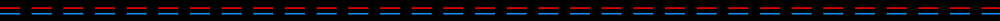

<!-- ANIMATED HUMANOID + ROBOT ARM BANNER -->

<!-- ANIMATED TYPING OF YOUR 3 ROLES -->

---

## 🎯 THE THREE PILLARS

| CV ENGINEER | ROBOTICS SOFTWARE ENGINEER | ROBOT BODY DEVELOPMENT |
|:---:|:---:|:---:|
| Perception pipelines for machines that **SEE** | Middleware & control for machines that **THINK** | Mechanisms & actuators for machines that **MOVE** |
| OpenCV • PCL • Open3D | ROS 2 • MoveIt • Nav2 | SolidWorks • FreeCAD • CadQuery |
| YOLO • MediaPipe • ZED/LiDAR | ros2_control • DDS • Real-Time C++ | STM32 • FOC • Harmonic Drives |
| Sensor fusion • VIO/SLAM | Motion planning • MPC • WBC | 3D printing • CNC • Tolerance design |
| TensorRT edge deployment | Sim2Real • Isaac Sim • MuJoCo | SEA/QDD actuators • Joint modules |

# THE ARSENAL: 16 DOMAINS OF PHYSICAL AI
*Every badge uses the tool's official brand color. Click any badge to view official docs/source.*

## 1. Core Languages & Computation

)

## 2. Robotics Middleware & Frameworks

## 3. Simulation, Physics & Digital Twins

## 4. Computer Vision, Perception & Sensors

## 5. Embodied AI, Learning & Inference

## 6. Mechanical Design & CAD

## 7. Manufacturing, Prototyping & 3D Printing

## 8. Mathematics, Optimization & Solvers

## 9. Motor Control, Actuation & Power

)

## 10. Embedded Systems & Microcontrollers

## 11. RTOS & REAL-TIME ENVIRONMENTS

## 12. Communication Protocols & Hardware Buses

## 13. Robot Architectures & Morphologies

)

)

## 14. Operating Systems & Linux Distributions

## 15. DevOps, CI/CD & Cloud Infrastructure

## 16. Databases, Telemetry & Data Engineering

## SYSTEM TELEMETRY

## DIRECT UPLINK

